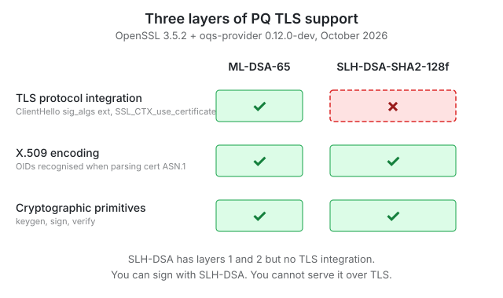

# pqc-bench

> Reproducible performance benchmarking of post-quantum TLS 1.3 across AWS regions.
> Measures what works today, documents what doesn't, and watches the gaps monthly.

[](https://github.com/asifmahbubnaeem/pqc-bench/issues?q=label%3Apq-tls-gap-monitor)


## TL;DR

- **ML-DSA-65** is production-ready for TLS termination on OpenSSL 3.5.0+ (nginx, Envoy, HAProxy). Its 3.3 kB signature fits in TCP initcwnd (14.6 kB), so there's **no measurable WAN handshake penalty** vs ECDSA.
- **SLH-DSA-SHA2-128f** has a ~17 kB signature that would need an extra round-trip at WAN RTT — but as of October 2026 you **cannot serve it over TLS at all**. OpenSSL 3.5.2 has the crypto and X.509 layers; the TLS layer is still missing. See [Part 4](#phase-4-the-slh-dsa-tls-gap).
- **Hybrid KEM (X25519MLKEM768)** is drop-in. The ClientHello extension overhead is negligible against WAN RTT.
- **1 MB payloads at 200 req/s saturate a c7g.large NIC**, not the crypto. Classical and PQ are statistically identical at that rate.

See the **[Blog series](#blog-series)** for the full write-ups.

## Blog series

| Phase | Scenario | Headline finding | Post |
|---|---|---|---|
| **1** | Fresh handshake latency, same-AZ | X25519MLKEM768 adds ~0.3 ms over X25519. Noise-level. | [Part 1](https://dev.to/asif_naeem_bd5842be56bfcd/pqc-bench-part-1-measuring-x25519mlkem768-costs-on-a-004hour-graviton3-2b2d) |
| **2** | Session resumption + payload sweep (100 B / 10 kB / 100 kB) | Resumption saves the full handshake cost (classical and PQ identical post-resumption). Payload latency dominated by RTT, not crypto. | [Part 2](https://dev.to/asif_naeem_bd5842be56bfcd/pqc-bench-part-2-where-the-x25519mlkem768-overhead-actually-matters-5hli) |
| **3** | Cert-chain size × WAN RTT (ECDSA / RSA-2048 / ML-DSA-65) across us-east-1, us-west-2, ap-northeast-1 | Cert-chain differences invisible at WAN RTT; 1.5 ms delta only at same-AZ ~1 ms. 1M payload failure in Phase 2 was NIC saturation, not crypto. | [Part 3](https://dev.to/asif_naeem_bd5842be56bfcd/pqc-bench-part-3-ml-dsa-65-certs-are-10x-bigger-than-ecdsa-and-dont-cost-a-thing-on-real-2ead) |
| **4** | SLH-DSA-SHA2-128f at WAN RTT (planned) | **Cannot measure.** OpenSSL 3.5.2 ships SLH-DSA crypto + X.509 but not TLS; oqs-provider 0.12.0-dev defers to default and doesn't fill the TLS gap either. | [Part 4](https://dev.to/asif_naeem_bd5842be56bfcd/pqc-bench-part-4-slh-dsa-over-tls-failed-5466) |
| **5** | Retrospective + what you can deploy today | ML-DSA is ready. Hybrid KEM is ready. SLH-DSA is production-ready for signing APIs, not for TLS termination. --WIP | (Upcoming) |

## Phase 4: the SLH-DSA TLS gap

Phase 4 planned to measure SLH-DSA-SHA2-128f cert chain latency at WAN RTT. The ~17 kB signature was expected to push the cert chain past TCP initcwnd and force one extra round-trip — the clean counterexample to Phase 3's "cert size is noise" finding.

The attempt uncovered a three-layer gap in OpenSSL's PQ support:

<p align="center">
  
</p>

| Layer | What it does | OpenSSL 3.5.2 | + oqs-provider 0.12.0-dev |
|---|---|:---:|:---:|
| **1. Cryptographic primitives** | `genpkey`, sign, verify | ✓ SLH-DSA, ML-DSA | ✓ |
| **2. X.509 encoding** | Cert ASN.1 parsing recognises OIDs | ✓ SLH-DSA, ML-DSA | ✓ |
| **3. TLS protocol integration** | `SSL_CTX_use_certificate`, ClientHello `sig_algs`, CertificateVerify | ✗ SLH-DSA, ✓ ML-DSA | ✗ SLH-DSA, ✓ ML-DSA |

**Nginx error when serving an SLH-DSA cert:**

```
nginx: [emerg] SSL_CTX_use_certificate("/tmp/t.crt") failed
    (SSL: error:0A0000F7:SSL routines::unknown certificate type)
```

Full capture: [`docs/phase-4-slhdsa-tls-gap-logs.md`](docs/phase-4-slhdsa-tls-gap-logs.md).

### Why oqs-provider didn't fix it

oqs-provider v0.12 (main as of Oct 2026) deprecated its own SLH-DSA registration because OpenSSL 3.5.2 added native keygen and signing. But OpenSSL's native implementation only covers layers 1 and 2 — the TLS layer wasn't included. Neither project owns the TLS integration for SLH-DSA right now.

```
$ /opt/openssl-3.5/bin/openssl list -signature-algorithms | grep SLH
  { 2.16.840.1.101.3.4.3.21, SLH-DSA-SHA2-128f } @ default
  (... zero entries @ oqsprovider)
```

### What you can deploy today

| You want to… | Status |
|---|---|
| Serve ML-DSA-65 cert over TLS 1.3 | ✓ Production-ready, OpenSSL 3.5.0+ |
| Serve SLH-DSA cert over TLS 1.3 | ✗ Not yet. No stack we tested supports it. |
| Sign JWT / firmware / packages with SLH-DSA | ✓ OpenSSL 3.5.2 genpkey + sign work |
| Use hybrid KEM (X25519MLKEM768) in TLS 1.3 | ✓ OpenSSL 3.5.0+, both ends |
| Store an SLH-DSA cert in your CA / certificate store | ✓ X.509 layer accepts it |

### Monitor status

A [GitHub Actions cron](.github/workflows/pq-tls-gap-monitor.yml) checks `openssl list -tls-signature-algorithms | grep slh` on the 1st of every month, with the latest OpenSSL 3.5.x and latest oqs-provider main. When the gap closes, it opens an alert issue and Phase 4 un-parks.

**[→ Live tracking issue](https://github.com/asifmahbubnaeem/pqc-bench-slh-dsa/issues/1)**

## Reproducing the benchmarks

Prerequisites: AWS account with an EC2 key pair named `pqc-bench-key`, Terraform ≥ 1.6, `aws` CLI configured as a profile `pqc-bench`.

### Phase 1–3 (classical + ML-DSA matrix)

```bash
cd terraform/phase-3
cp terraform.tfvars.example terraform.tfvars    # edit allowed_ssh_cidrs
terraform init
terraform apply                                 # ~1 min loadgen + target boot
./scenarios/04-cert-chain-size/run.sh 60 3      # ~15 min for a 3-arm, 3-trial sweep
terraform destroy
```

### Phase 4 (demonstrates the gap)

```bash
# From the slhdsa-attempt branch
cd terraform/phase-3
terraform apply   # ~35 min — rebuilds OpenSSL 3.5.2 + oqs-provider from source

# Inside the target, reproduce the failure:
ssh ubuntu@$(terraform output -raw target_public_ip)
/opt/openssl-3.5/bin/openssl genpkey -algorithm SLH-DSA-SHA2-128f -out /tmp/t.key
/opt/openssl-3.5/bin/openssl req -new -x509 -key /tmp/t.key \
    -out /tmp/t.crt -days 365 -subj "/CN=test"
/opt/openssl-3.5/bin/openssl s_server -key /tmp/t.key -cert /tmp/t.crt \
    -accept 127.0.0.1:8443 -tls1_3
# Expect: error:0A0000F7:SSL routines:ssl_set_cert:unknown certificate type
```

### Cost

Across all five phases, total EC2 spend has been **~$5 USD** (c7g.large on-demand, destroyed between runs). Phase 4 was ~$0.25 across two failed bakes.

## Architecture

Three terraform modules, two of which are shared sub-modules:

- `terraform/bench/` — single-AZ loadgen + target for Phases 1 and 2 (same-region baseline).
- `terraform/phase-3/` — three-region cross-region loadgen (count-gated by `loadgen_region`), persistent us-east-1 target. Phase 3 and (attempted) Phase 4.
- `terraform/target/` — shared target module (nginx-pq + OpenSSL + optional oqs-provider).
- `terraform/loadgen/` — shared loadgen module (OpenSSL 3.5 for `s_time`, Gatling + JMeter for legacy scenarios).

User-data templates:

- `user-data-full.sh.tftpl` — full build from stock Ubuntu, ~35 min with oqs-provider.
- `user-data-fast.sh.tftpl` — regenerates certs + nginx config on a pre-baked AMI, ~1 min.

Scenario drivers in `scenarios/`.


## Status

- Phases 1–3: complete, published, numbers in `results/`.
- Phase 4: parked. Technical gap documented. Monitor live.
- Phase 5: complete, retrospective shipped.
- Next unpark date: whenever [the monitor](https://github.com/asifmahbubnaeem/pqc-bench-slh-dsa/issues/1) reports SLH-DSA in a TLS stack.

## Contact

Asif Mahbub Naeem — [GitHub](https://github.com/asifmahbubnaeem)
[Email](asifnaim0123@gmail.com)

## License

MIT. See [LICENSE](LICENSE).
